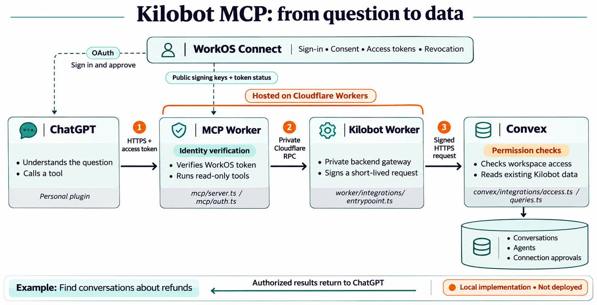

# Kilobot MCP private pilot

Status (2026-11-17): read-only conversation tools are connected in ChatGPT staging through the existing `kilobot` Worker and development Convex. Real authenticated discovery verified the connected organization and Personal agents. New/pending connections activate after validated consent. The new agent snapshot backend is verified in development; its private gateway module and MCP staging deployment remain pending. No customer-facing production release.

## Components

The image was generated before staging deployment. Current MCP access uses workers.dev rather than a custom domain. Data access requires validated OAuth consent, an active connection and current workspace authorization.

Current MCP version: `55b5f8c4-1b34-4004-ba89-f51898f48e55`. `KILOBOT_BACKEND` points to `kilobot#KilobotIntegrationEntrypoint`. The production Worker has a private entrypoint and dedicated development integration configuration; its original website module and frontend data binding were preserved. Development Convex `outstanding-rabbit-215` has the integration functions and signing verification configuration deployed. The old `kilobot-integration-staging` Worker remains unused.

ChatGPT personal plugin → `mcp/index.ts` (separate MCP Worker) → private named `KilobotIntegrationEntrypoint` on Kilobot Worker → `POST /integrations/mcp/read` on development Convex → internal workspace-authorized reads. MCP never holds a Convex URL or client. The ordinary Kilobot frontend handler remains separate from the named private RPC entrypoint.

Use Node 22 before every script/test command: `source "$HOME/.nvm/nvm.sh" && nvm use 22 && ...`.

## WorkOS development setup

Issuer: `https://mighty-nacre-26-staging.authkit.app`.
Active MCP resource: `https://kilobot-mcp-staging.leykwan132.workers.dev/mcp`; exact bytes must match the WorkOS Resource Indicator, token audience and MCP metadata. Replace the earlier proposed custom-domain resource for this pilot.

The private Kilobot entrypoint's `CONVEX_INTEGRATION_URL` is configured to `https://outstanding-rabbit-215.convex.site/integrations/mcp/read`. This is separate from the live website's `CONVEX_URL`. Running `npx convex dev` locally deploys changes to this cloud development backend; a backend truly hosted on localhost would instead require a reachable tunnel.

Public discovery fetched on 2026-11-16 confirms authorization-code/refresh grants, S256 PKCE, the expected issuer and JWKS. Latest discovery advertises CIMD support and a dynamic registration endpoint. Authenticated staging discovery has verified token issuer/audience and server-side introspection for the connected ChatGPT client. Provider revocation and refresh-token renewal still require explicit live acceptance testing.

Create a first-party OAuth application in the SAME staging WorkOS environment for server-side introspection. Its client ID may be a regular MCP variable; its client secret belongs in the MCP secret store. Both are present in staging. Deploy with `--keep-vars` to preserve the dashboard-managed client ID. Public CIMD/DCR clients cannot authenticate to introspection themselves; WorkOS permits the first-party application to introspect eligible public-client consent-backed access tokens. Verify this against a real test token before enabling tools.

Use existing native ORGANIZATION accounts with current `chats:read` permission. A consented connection reads both its connected organization and the authenticated owner’s personal workspace. Discovery labels agent names by workspace and paginates the organization before Personal. Personal reads require the owning WorkOS user on records and channels. Other organizations and partner workspaces remain unsupported. Validated consent activates new/pending connections automatically; revoked connections stay blocked.

## Configuration ownership

| Service                | Non-secret configuration                                                                                                                                                         | Secret configuration                                                          |
| ---------------------- | -------------------------------------------------------------------------------------------------------------------------------------------------------------------------------- | ----------------------------------------------------------------------------- |
| MCP Worker             | `MCP_ENABLED`, `MCP_RESOURCE`, `WORKOS_ISSUER`, `WORKOS_JWKS_URL`; private `KILOBOT_BACKEND` binding; limiter namespace                                                          | `WORKOS_INTROSPECTION_CLIENT_ID`, `WORKOS_INTROSPECTION_CLIENT_SECRET`        |
| Kilobot gateway Worker | `INTEGRATION_ENABLED`, `INTEGRATION_ENVIRONMENT=staging`, `CONVEX_INTEGRATION_URL` ending exactly `/integrations/mcp/read`, `INTEGRATION_KEY_ID`, existing frontend `CONVEX_URL` | `INTEGRATION_SIGNING_KEY` (RS256 PKCS8 PEM)                                   |
| Development Convex     | `INTEGRATION_ENABLED`, `INTEGRATION_ENVIRONMENT=staging`, `WORKOS_CONNECT_ISSUER`, `INTEGRATION_VERIFICATION_JWKS` (public keys)                                                 | `INTEGRATION_CURSOR_SECRET` (at least 32 cryptographically random characters) |

The checked-in MCP config is enabled for this staging pilot. The separate unused gateway config remains disabled. Existing production website routing is unchanged. Store local secrets in gitignored `.dev.vars` files or service secret stores, never in Wrangler vars/source/docs. Never log token/key values. No Convex deploy/admin key belongs in either runtime.

Generate the RS256 key pair using maintained jose tooling. Upload only the private key to the Kilobot Worker secret store and only its public JWK (including matching `kid`) to Convex. Keep signing keys and cursor secrets distinct across environments. A public JWKS may be copied to configuration; the private key must never be pasted into a chat or committed.

## Local verification

1. With Node 22 run `npx vitest run shared/integrations mcp convex/integrations`.
2. Run `npx tsc -p mcp/tsconfig.json` and `npx tsc -p convex/tsconfig.json --noEmit`.
3. Run scoped ESLint, relevant existing backend tests and the app build.
4. Dry-run MCP: `WRANGLER_LOG_PATH=/private/tmp/kilobot-mcp-wrangler.log WRANGLER_SEND_METRICS=false npx wrangler deploy --dry-run --config mcp/wrangler.jsonc --outdir /private/tmp/kilobot-mcp-build`.
5. Dry-run gateway: same prefix, `npx wrangler deploy --dry-run --config worker/integrations/wrangler.staging.jsonc --outdir /private/tmp/kilobot-backend-build`. Staging uses the same private integration entrypoint exported by the Kilobot Worker, with a separate wrapper returning HTTP 404. It does not upload website assets or require an app build.

Do not infer a live deployment from a successful dry-run or local tests. Convex codegen does not deploy backend functions; network component-analysis failure must be reported separately from local type generation.

## Staging rollout after configuration review

1. Deploy development Convex schema/functions while integration is disabled.
2. Keep the direct `kilobot` private entrypoint's integration endpoint on development Convex; supply its dedicated signing key/environment configuration. Do not alter the website's existing `CONVEX_URL`.
3. Provision MCP introspection secrets on `kilobot-mcp-staging`; its existing workers.dev URL needs no custom DNS setup. Source deployment configuration is `mcp/wrangler.jsonc`.
4. Set development Convex/private-entrypoint/MCP integration switches to true only after provider discovery, key mapping and exact development endpoint are verified. Production data access is not part of this pilot.
5. In ChatGPT Plugins choose Add custom MCP server, the staging `/mcp` URL, and OAuth; choose CIMD if available. Copy actual callback/client metadata values from ChatGPT's configuration when needed. Never invent redirect allowlist entries.
6. Create/install the personal plugin, then invoke it in ChatGPT Work. A first tool call activates the connection after validated consent and live workspace authorization.

## Pilot approval and disconnect

These are INTERNAL functions, executed only by an authorized project operator against development Convex. They are not exposed as MCP tools or public user API endpoints. Use the Convex Dashboard function runner or authenticated CLI with Node 22; omit `--prod` throughout this pilot.

1. `integrations/connections:listPilotConnections` with `{"subject":"<actual WorkOS user ID>"}` returns at most 100 metadata records. Inspect the exact issuer, org, client and consent with the test account owner. Obtain these values from actual tokens/connection records, not email guessing.
2. `integrations/connections:approvePilotConnection` takes `connectionId`, `expectedIssuer`, `expectedSubject`, `expectedOrgId`, `expectedClientId`. All must match; current member permission is revalidated. This is an operator recovery path; ordinary new/pending connections activate after validated consent.
3. `get_connection_context` returns bounded eligible agents from the connected organization and the owner’s Personal workspace. Follow `nextCursor` to visit both scopes. Use its agent ID in search; use a returned conversation ID in retrieval. Do not guess IDs.
4. `integrations/connections:revokePilotConnection` takes `connectionId`. The NEXT data read must fail even if its access token remains valid. Already in-flight authorized reads may finish.
5. Reconnecting can reuse the WorkOS consent ID; it never automatically reactivates a revoked local grant. Repeat explicit approval only after operator/user review. Provider-level consent revocation is separately enforced through introspection.

## Acceptance checklist

- [x] Real WorkOS discovery advertises CIMD; MCP resource metadata returns the configured staging audience. The connected ChatGPT client passes issuer/audience validation.
- [ ] First-party introspection works for ChatGPT's actual client and rejects provider-revoked consent.
- [ ] Two different native organizations see only their own agents/conversations.
- [x] Validated consent activates new/pending connections automatically; existing revoked connections remain blocked (automated tests).
- [x] Personal records are owner-scoped; partner workspaces, wrong audience/issuer, expired tokens and tampered assertions/cursors deny explicitly (automated tests).
- [ ] Agent discovery, indexed summary search and actual Agent-thread text paging work in ChatGPT.
- [ ] Removing membership/permissions, deleting a workspace and local/provider revocation deny subsequent reads.
- [ ] Token renewal works without manual token copying; no raw OAuth tokens are persisted by our services.
- [ ] Concurrent users cannot share auth context. Limits and deadlines fail explicitly without returning partial success.
- [ ] Private RPC is unreachable from ordinary public HTTP paths.
- [ ] Logs contain no bearer tokens, assertions, query text, system prompts, message bodies or credentials.

## Operations and rollback

Audit retention is 30 days; hourly cleanup removes expired rows in batches of 200 and schedules immediate follow-up batches until drained. Audit data records the signed request ID, outcome, elapsed time and result count without message content or tokens. Limiter stores per-consent counters in Durable Objects and clears idle storage through alarms. No MCP session database is used.

Rotate service keys by publishing the new public JWK first, switching the gateway signer/kid second, and removing the old JWK after at least 35 seconds. For compromise, remove the old public JWK immediately. Cursor-secret rotation invalidates existing page cursors and requires starting pagination again.

Rollback: disable MCP, disable gateway/Convex integration switches and revoke pilot grants. Keep regular website/auth settings intact. Disable/remove the private service binding if needed. No public plugin submission or production changelog until the user confirms production availability.

## References

- https://developers.openai.com/plugins/quickstart
- https://developers.openai.com/api/docs/guides/custom-mcp-server
- https://workos.com/docs/authkit/mcp
- https://workos.com/docs/authkit/connect/token-claims
- https://workos.com/docs/reference/workos-connect/introspection

## Agent snapshot (development backend ready; MCP activation pending)

`get_agent_snapshot` accepts only `agentId` from connection context. It returns a capture timestamp, the agent/workspace, current connected-inbox totals, unread conversations and unread messages separately, chats requiring attention, chats without a human assignee, chats with bookings, counts by platform/status, last activity, and up to five newest conversations. Playground history and disconnected channels are excluded. Platform totals cover WhatsApp, Instagram, Messenger, Web and Avatar. Escalated counts match the Inbox’s `requires_user_input` status. Booking counts represent conversations with a current booking, not a count of appointments. Recent conversation IDs can be passed to `get_conversation`.

Counts reuse Inbox counters; status and unread-message buckets require the existing idempotent `inboxEscalationCounts:backfill` with `{"cursor":null}` after deployment. The new snapshot fails explicitly with `SNAPSHOT_NOT_READY` until its final batched backfill writes `snapshot-backfill-complete`. Reads do not scan chat history. Personal snapshots check agent ownership and use owner-scoped counters. Recent conversation previews also recheck live channel and conversation access.

On 2026-11-17, backend deployment, backfill and a live Kilobot snapshot passed in development. MCP/private Worker packages are built and verified; activation requires updating the private integration module and MCP staging deployment. Preserve website modules/configuration and deploy the MCP Worker with `--keep-vars`.
