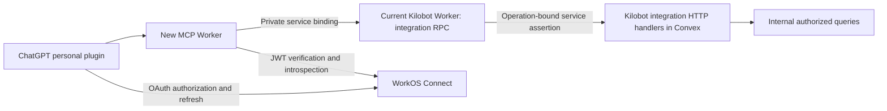

# Kilobot MCP architecture proposal

Status: implementation authorized by user on 2026-11-16; local pilot code implemented, private staging Workers deployed with integration disabled and binding metadata verified. Hosted end-to-end acceptance pending. No WorkOS settings, DNS, production Worker or Convex deployment changed.

## Intent and constraints

Build our own MCP server and connect it as a personal ChatGPT plugin using OpenAI's quickstart. WorkOS Connect supplies OAuth. Preserve the user-required boundary: ChatGPT → MCP server → current Kilobot backend → Convex. Start with a private, read-only pilot; public directory submission, custom UI, replies, booking changes, personal API keys, and white-label accounts are later projects.

Use Node 22 for every script/test execution; explicitly select it in each shell. Keep each code file below 300 lines, including tests. Reuse existing libraries and business logic; fail explicitly on missing configuration or unsupported identity. No fallback from an organization to a personal workspace. No production changelog until actual release availability is confirmed.

## Repository findings

- `wrangler.jsonc` deploys Worker `kilobot` from `worker/index.ts`.
- That Worker serves frontend assets and partner metadata; it is not currently a general authenticated API. The proposed backend interface is NEW, not an existing endpoint we have verified.
- Business operations, HTTP handlers and data live under `convex/`; `convex/http.ts` already registers backend HTTP routes.
- `convex/authUtils.ts` handles session identities, mutable active teams and partner entitlement surfaces. Do not pretend WorkOS Connect tokens are ordinary AuthKit session tokens or reuse mutable activeTeamId as a delegated authorization boundary.
- `convex/teamAccess.ts`, `convex/teamHelpers.ts`, `shared/permissions.ts` contain membership and role logic. Read access uses `chats:read`.
- `convex/inboxSearch.ts` and indexed inbox projections provide existing search behavior; Agent threads hold message content.
- Existing unrelated working changes must remain untouched.

## Approaches considered

1. Recommended: separate MCP Worker calling a named private RPC entrypoint exported by the current Kilobot Worker. Add narrowly scoped backend handlers behind that entrypoint. Keeps independent MCP deployment and the required backend boundary, without exposing another public API.
2. Public versioned Kilobot HTTPS API called by MCP. Useful if external developers immediately need the same API; adds public service authentication, replay protection and API lifecycle work. Defer.
3. MCP calls Convex directly. Rejected by the user.

Recommendation is not yet approved. If the user means another backend outside this repository, stop before implementing the proposed Worker gateway and map to that service instead.

## Services and trust boundaries

Production MCP endpoint proposal: `https://mcp.kilobot.app/mcp`. Canonical OAuth resource: that exact URL. Staging uses its own hostname, AuthKit environment, service binding target, signing key and development Convex deployment. Hostname availability is UNCONFIRMED.

The MCP Worker has no Convex URL, deploy key, Convex client, database credentials or backend signing key. It only knows WorkOS public configuration, first-party introspection credentials and its private Kilobot binding. The Kilobot Worker alone holds the backend assertion signing key and Convex HTTP URL. Convex integration handlers hold only verification public keys.

The private RPC entrypoint MUST NOT dispatch from public HTTP, including workers.dev or preview routes. Plain caller-controlled identity headers are never trusted. A private binding authorizes the MCP service to supply a verified principal; backend data authorization remains mandatory.

## OAuth and revocation

1. WorkOS: enable CIMD; keep DCR off unless a tested client needs it. Register the exact resource indicator separately in each environment.
2. MCP: serve protected-resource metadata and standards-compliant 401 challenges identifying WorkOS. WorkOS hosts authorization-server metadata and JWKS.
3. ChatGPT runs authorization code + PKCE; WorkOS authenticates and obtains consent, including organization selection.
4. MCP verifies signature, allowed algorithm, exact issuer and audience, required expiration and subject, client_id, consent sid and org_id. Reject agent/M2M tokens and unsupported missing-org tokens for this pilot.
5. MCP introspects each protected tool call with a first-party WorkOS application's credentials. Require active access-token status and matching subject, organization, client and consent claims; provider timeout/error denies access with a retryable service error. No active-status cache in the pilot. Public CIMD clients cannot introspect on their own.
6. ChatGPT holds access/refresh tokens and performs renewal. Our services do not persist raw OAuth tokens or refresh tokens. Public signing keys may be cached.
7. Local connection records keyed by `(issuer, sid)` store user identity, client, exact org, status and read-only capability ceiling. First authenticated use may create only a PENDING record after membership/pilot eligibility validation, never an enabled grant. For the private pilot, an operator explicitly approves the exact test-user/org/client/consent tuple using a reviewed internal mutation. User approval in a future settings screen is a separate UI deliverable. Disconnect marks the record revoked; no automatic reactivation. WorkOS may reuse consent IDs: reconnection then requires explicit operator reapproval of that exact tuple, recorded in audit, rather than assuming a new sid. A local disconnect blocks new calls even while a JWT remains valid; provider revocation is additionally detected by introspection. Operator approval/revoke is mandatory for the pilot; customer self-service UI is required before broader availability.

CIMD/DCR clients receive standard OIDC scopes by default. Do NOT request or advertise `chats:read` as an OAuth scope until WorkOS has enabled the corresponding custom scopes; OIDC scope `openid` never means permission to read chats. The pilot uses explicit operator-approved grants for consenting test accounts plus current backend `chats:read` permission. Review hosted consent wording before connecting data; no real customer rollout until data-access approval is clearly disclosed and customer approval/disconnect flows exist. This must be demonstrated in the staging gate.

## Backend identity delivery

MCP sends a verified principal and a typed read operation through the private RPC binding. The Kilobot backend signs a NEW 30-second RS256 assertion for its own Convex integration HTTP endpoint; it never forwards the WorkOS MCP token downstream as an API credential.

Assertion fields: issuer `kilobot-integration-gateway`, audience `kilobot-integration-api`, expiry, issued-at, random jti, original identity issuer and subject, orgId, consentId, clientId, grantedScopes, operation, method `POST`, path `/integrations/mcp/read`, and SHA-256 of the exact request body bytes. Only that fixed method/path dispatches the three allowed operations. Environment-specific public keys selected by kid. Verifier allows at most 5 seconds clock tolerance and rejects lifetime over 30 seconds, wrong body, method, path, operation, environment or signature. Rotate by deploying new verification public key first, switching signer second, and retiring old key after maximum assertion lifetime plus tolerance; emergency compromise removes the old verification key immediately. Assertions authorize read operations only; replay may repeat an authorized read, with current grant/membership checks still required. First-use connection creation and audit append are bounded metadata effects, never business-data writes. Business writes require a separate design with replay/idempotency controls.

Assertions are accepted ONLY by dedicated integration HTTP handlers, not added to general `convex/auth.config.ts`. After verification, handlers invoke internal functions with verified context; no public query accepts an arbitrary userId as proof of authorization. Do not use a Convex admin/deploy key.

This deliberately separates service authentication from user authorization. Every data read resolves current local user, exact organization-to-team mapping, current active membership, native entitlement surface, workspace availability, grant status, permission and record ownership inside the backend transaction. Reuse pure membership/permission helpers where possible. Never infer partner entitlement from a native token; reject partner workspaces in the pilot. Scope personal teams separately in a future design because current personal org IDs are empty strings.

## Initial tools and contracts

- `get_connection_context`: `{agentLimit?, agentCursor?}` with limit default 10/max 25; connected workspace name, read-only capabilities and a paginated list of accessible agent IDs/names. No tokens or unrelated workspace list. Pending/revoked connections receive approval-required/denied errors and no workspace data.
- `search_conversations`: `{agentId, query, limit?, cursor?}`; query length 1–200, limit default 10/max 25, indexed title/customer search using current projection semantics. No claim of semantic or full message search.
- `get_conversation`: `{conversationId, limit?, cursor?}`; up to 50 text messages per page with timestamps and sender type. Attachments return safe metadata only, never signed media URLs or secrets.

Resolve workspace from verified consent, never model input. All agent/conversation/thread lookups check the same workspace. Cross-workspace or inaccessible IDs return a generic not-found error. Cursors are bound to operation, consent, organization and input; foreign/tampered cursors fail. Return bounded field allowlists, a next cursor and a validated Kilobot link only when the existing UI route supports it. Cap each response at 128 KiB; preserve explicit truncation/pagination signals and never split UTF-8 bytes.

All tools declare read-only, non-destructive annotations and strict input/output schemas. Conversation text is untrusted content, never instructions. Do not expose raw database tools, credentials, internal prompts or arbitrary fetch/URL tools.

## Operational plan

Use official MCP TypeScript SDK with stateless Streamable HTTP after a Workers runtime compatibility check; `jose` for maintained JWT/JWKS implementation and existing Zod for contracts. No custom OAuth protocol implementation. Qualify versions and licenses before installation.

Limits: 30 tool calls/minute per consent per environment, enforced by a SQLite-backed Durable Object class `ConsentRateLimiter` keyed by SHA-256 of issuer/consent, using transactional fixed 60-second windows (not isolate-local memory); register its namespace and migration in MCP Wrangler config. This stores counters, not MCP session state. Apply a separate transport/IP abuse limit before expensive introspection. Limit request bodies to 20 KiB and total tool execution to 10 seconds. Propagate request IDs, explicit auth/permission/rate-limit/upstream errors. Audit operation, connection ID, workspace, result count, duration and outcome, excluding bearer tokens, assertions, query text and message bodies. Audit retention starts at 30 days with batched cleanup; record approved retention before public release.

MCP and backend changes stay in this repository with separate deployment configs. Deploy backend compatibility first, MCP second. Rollback disables the integration/grants and removes the binding or MCP deployment; normal website sessions are unaffected. No public submission or production enablement during the private test.

## Review gates and success criteria

- Confirm the current Worker is the intended Kilobot backend; otherwise revise the gateway before implementation.
- Demonstrate WorkOS CIMD + PKCE + exact resource audience + refresh + introspection using test users, including a revoked consent.
- Confirm WorkOS organization selection maps to a native Kilobot team. Pilot uses two test users in different organizations, plus a removed member.
- Confirm consent disclosure, account eligibility, token/profile shape and client-ID allowlisting policy for the private pilot; no guessed production client IDs.
- Pass isolation, revoked grant, removed membership, wrong audience, expired token, tampered assertion/cursor, oversized payload and upstream failure tests.
- Connect through OpenAI's personal-plugin flow with OAuth, invoke three tools in ChatGPT Work, then disconnect and prove subsequent calls fail.
- No tests run or implementation claimed in this proposal. No customer-facing release; changelog unchanged.

## Sources checked 2026-11-16

- https://developers.openai.com/plugins/quickstart
- https://developers.openai.com/api/docs/guides/custom-mcp-server
- https://developers.openai.com/plugins/build/auth
- https://workos.com/docs/authkit/mcp
- https://workos.com/docs/authkit/connect/token-claims
- https://workos.com/docs/reference/workos-connect/introspection
- https://developers.cloudflare.com/workers/runtime-apis/bindings/service-bindings/rpc/
